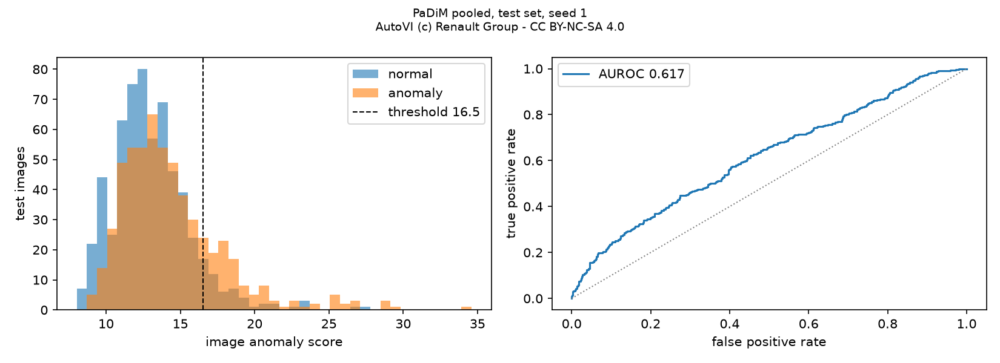

# Industrial Anomaly Detection on AutoVI — Stage 1 report

*AI for Trustworthy Decision Making. Stage 1: baseline development and minimal federated setup.*

Every number in this report is a mean ± sample standard deviation over seeds 1, 2, 3
and can be traced to a file in [`results/stage_01/`](../results/stage_01) or to a saved
notebook output. The commands that produce them are in the [README](../README.md).

## 1. Motivation and problem definition

An inspection camera on a car assembly line takes one photo of a mounted part. The
task is to decide whether the part is correctly mounted or defective, and to show
where the defect is.

Two properties of the setting shape the project:

- **Defects are rare and varied.** A factory has many photos of good parts and few,
  changing examples of defects. We therefore use an *unsupervised* model that learns
  only from normal images and flags what looks different.
- **Images stay where they are taken.** Each inspection station (one per part type)
  keeps its own images. We want one shared model without moving images to a central
  place, which is what federated learning provides.

Research questions for Stage 1:

1. How well does a simple unsupervised model (PaDiM) detect defects on real factory images?
2. Is a station better served by a model built from all stations or by its own model?
3. Can the shared model be built federated, and what does that cost in accuracy?
4. How different are the stations from each other, in numbers?

## 2. Related work

- **AutoVI** (Carvalho et al., 2024) is the dataset and the reference benchmark: six
  unsupervised methods on real Renault assembly-line images. PaDiM reaches a mean
  image-level AUROC of 71.2% there, well below its 97.9% on the cleaner MVTec AD.
- **PaDiM** (Defard et al., 2021) models, for every image position, the distribution
  of features of a frozen pretrained network on normal images, and scores a test
  patch by its Mahalanobis distance to that distribution.
- **FedAvg** (McMahan et al., 2017) is the standard federated algorithm: clients train
  locally and a server averages their model weights, weighted by sample count.
- **Non-IID data in federated learning.** Hsu et al. (2019) introduce the Dirichlet
  parameter α to control label skew between clients; Kairouz et al. (2021) survey why
  such differences degrade federated training.
- **Flower** (Beutel et al., 2020) is the federated learning framework used here.

## 3. Dataset and preprocessing

AutoVI contains photos from Renault assembly lines. We use the three categories that
are delivered at 400 × 400 pixels. AutoVI's own split has normal images only in the
training folder; every defect is in the test folder.

| Category | Normal | Defect | Total | Defect % |
|---|---:|---:|---:|---:|
| engine_wiring | 570 | 322 | 892 | 36.1 |
| pipe_clip | 390 | 142 | 532 | 26.7 |
| pipe_staple | 379 | 117 | 496 | 23.6 |
| All | 1339 | 581 | 1920 | 30.3 |

Preprocessing (details in [`data_lead.ipynb`](../notebooks/stage_01/data_lead.ipynb)):

- **Duplicates.** 73 images are byte-identical copies of another image (60 pairs in
  engine_wiring, 13 in pipe_clip). They are removed, leaving 1847 images.
- **Format.** engine_wiring is RGB, the other two are RGBA; all are converted to RGB.
- **Size.** Images are resized to 128 × 128 for all experiments in this report.
- **Leak check.** No image is shared between train/validation and test, or between
  two clients.

Two splits are used, each with **one client per production part** (3 clients):

| | A. Labelled split | B. Official AutoVI split |
|---|---|---|
| Built by | `split_data.py`, grouped by category, 20% test, seed 42 | `autovi_official_partitions.py` |
| Normal training images per client | 348 / 266 / 242 | 242 / 166 / 162 |
| Defects in train and validation | yes | none |
| Test set | 382 images (264 normal, 118 defects) | 1176 images (608 normal, 568 defects) |
| Used for | PaDiM notebook, supervised CNN | PaDiM centralised vs. federated |

Split B follows the dataset's protocol and is the one comparable with the paper.
Split A exists because a supervised classifier needs defects in training.
**Numbers from A and B must not be compared with each other.**

How different the clients are (split A, from the data notebook):

- **Size:** 570 / 348 / 326 training images; size Gini 0.131.
- **Labels:** defect rate 38.9% / 23.6% / 25.8%; mean EMD to the global label mix 0.139,
  which corresponds to a Dirichlet split with α ≈ 10 (a mild skew).
- **Appearance:** mean brightness 0.471 / 0.426 / 0.195. A linear model on four
  pixel statistics identifies the station of an image with 97.3% accuracy.

So the real stations differ mildly in size and labels and strongly in appearance.

## 4. Baseline model

**PaDiM.** A ResNet18 pretrained on ImageNet, frozen, produces patch features from
its first three stages (448 channels on a 32 × 32 grid for a 128 × 128 image). A random
subset of 100 channels is kept; this is the only random choice, so it is what the seed
controls. For each grid position the model stores the mean and the covariance of the
features over the normal training images. A test image gets an anomaly map (the
Mahalanobis distance at each position, upsampled and smoothed) and a score (the
maximum of the map). The decision threshold is the 95th percentile of the scores of
normal validation images, so no defect and no test image is used to set it.

**Supervised CNN (for the FedAvg experiment).** A small convolutional classifier
(normal vs. defect) trained with Adam, learning rate 0.001, batch size 32.

## 5. Federated setup

Three clients, one per production part, simulated on one machine.

**PaDiM.** Mean and covariance are functions of two sums over the training images:
the sum of the features `S` and the sum of their outer products `Q`. Each client
computes `(n, S, Q)` on its own normal images and sends them; the server adds them,
computes the mean and covariance and inverts once. A sum over all images equals the
sum of the per-client sums, so the result is the model that pooled training would
give. This is a sample-weighted average of client statistics, as in FedAvg, but it
needs one round and is exact. The server draws the channel subset and sends it to all
clients. Details: [`docs/federated_padim.md`](federated_padim.md).

**CNN.** Standard FedAvg: 10 rounds, 1 local epoch per round, all clients every
round, sample-weighted averaging of the weights.

Both are implemented as a Flower app (`fl_app/`) and as a plain in-process simulation
(`experiments/federated.py`); the two give the same results (Section 6).

## 6. Preliminary results

### 6.1 PaDiM, centralised vs. federated (split B)

| Training | AUROC | AP | Balanced acc. | TPR | TNR |
|---|---|---|---|---|---|
| Centralised (pooled images) | 0.624 ± 0.017 | 0.619 ± 0.012 | 0.564 ± 0.009 | 0.191 ± 0.026 | 0.937 ± 0.016 |
| Federated, Flower, 1 round | 0.624 ± 0.017 | 0.619 ± 0.012 | 0.564 ± 0.009 | 0.191 ± 0.026 | 0.937 ± 0.016 |
| Federated, in-process | 0.624 ± 0.017 | 0.619 ± 0.012 | 0.564 ± 0.009 | 0.191 ± 0.026 | 0.937 ± 0.016 |

Per seed, the federated and centralised AUROC differ by at most 2 × 10⁻⁶. The
federated model is the centralised model.

*Pooled PaDiM, seed 1, split B. The score distributions of normal and defective
images overlap strongly.*

### 6.2 Shared model vs. one model per station (split B)

AUROC of each model on the test images of one station:

| Station | Shared (pooled) model | Station's own model | Paper, PaDiM |
|---|---|---|---|
| engine_wiring | 0.728 ± 0.012 | 0.726 ± 0.014 | 0.792 ± 0.013 |
| pipe_clip | 0.510 ± 0.009 | 0.566 ± 0.010 | 0.626 ± 0.020 |
| pipe_staple | 0.509 ± 0.071 | 0.651 ± 0.082 | 0.546 ± 0.030 |
| Mean | 0.582 ± 0.023 | 0.648 ± 0.026 | 0.655 |

The shared model equals the local one for engine_wiring and is close to random for
the other two stations. The paper's scores are given for context only: it trains one
model per category at a larger image size.

The PaDiM notebook shows the same pattern on split A (pooled vs. local validation
AUROC: 0.743 vs. 0.761, 0.646 vs. 0.730, 0.618 vs. 0.776), with a pooled test AUROC
of 0.654 ± 0.001.

### 6.3 Supervised CNN, centralised vs. FedAvg (split A)

| Training | Accuracy | Balanced acc. | Macro-F1 | Worst client, val. balanced acc. |
|---|---|---|---|---|
| Centralised, 10 epochs | 0.913 ± 0.012 | 0.887 ± 0.008 | 0.896 ± 0.013 | 0.854 ± 0.009 |
| FedAvg, Flower, 10 rounds | 0.869 ± 0.009 | 0.849 ± 0.003 | 0.847 ± 0.008 | 0.788 ± 0.030 |
| FedAvg, in-process, 10 rounds | 0.866 ± 0.020 | 0.854 ± 0.009 | 0.846 ± 0.018 | 0.761 ± 0.026 |

FedAvg loses about 3 to 4 points of balanced accuracy against centralised training,
and more for the worst-served client. This model sees defects during training, so it
only recognises the defect types it was shown and its scores are not comparable with
PaDiM's.

## 7. Limitations and trust dimensions for Stage 2

Limitations observed:

- **Unsupervised detection is modest.** AUROC 0.62 to 0.65; with 95% of good parts
  accepted, about 1 defect in 5 is caught.
- **Small images.** 128 × 128 inputs from 400 × 400 originals; some defects are small.
- **One shared model for three different parts.** Pooling, and therefore federation,
  is worse than a local model for two of three stations. PaDiM stores one distribution
  per image position, and three different parts at the same position make "normal" too wide.
- **Anomaly maps are not yet reliable.** Normal images also show highlighted regions.
- **Three of six AutoVI categories** are used.
- **The statistics a client sends are not private by default.** `S/n` is the client's
  mean feature map.

Trust dimensions proposed for Stage 2 (the team must cover at least two):

| Dimension | Question | Planned measurement |
|---|---|---|
| Robustness | What happens if one client sends statistics of defective or shifted images? | AUROC of the shared model with 0, 1 corrupted client; a server-side check of client statistics |
| Fairness across stations | Is the worst-served station acceptable? | Worst-station AUROC next to the mean; a shared backbone with per-station statistics or thresholds |
| Privacy | How much do `S` and `Q` reveal, and what does protecting them cost? | Calibrated noise on `S` and `Q`; AUROC as a function of the noise level |
| Interpretability | Do the anomaly maps point at the defect? | Overlap of the maps with AutoVI's defect masks |

## References

1. Carvalho, P., Lafou, M., Durupt, A., Leblanc, A., Grandvalet, Y. (2024). Detecting
   visual anomalies in an industrial environment: Unsupervised methods put to the test
   on the AutoVI dataset. *Computers in Industry* 163, 104151.
2. Defard, T., Setkov, A., Loesch, A., Audigier, R. (2021). PaDiM: a Patch Distribution
   Modeling Framework for Anomaly Detection and Localization. *ICPR Workshops*.
3. McMahan, H. B., Moore, E., Ramage, D., Hampson, S., Arcas, B. A. y (2017).
   Communication-Efficient Learning of Deep Networks from Decentralized Data. *AISTATS*.
4. Hsu, T.-M. H., Qi, H., Brown, M. (2019). Measuring the Effects of Non-Identical Data
   Distribution for Federated Visual Classification. arXiv:1909.06335.
5. Kairouz, P., McMahan, H. B., et al. (2021). Advances and Open Problems in Federated
   Learning. *Foundations and Trends in Machine Learning* 14(1–2).
6. Beutel, D. J., et al. (2020). Flower: A Friendly Federated Learning Framework.
   arXiv:2007.14390.
